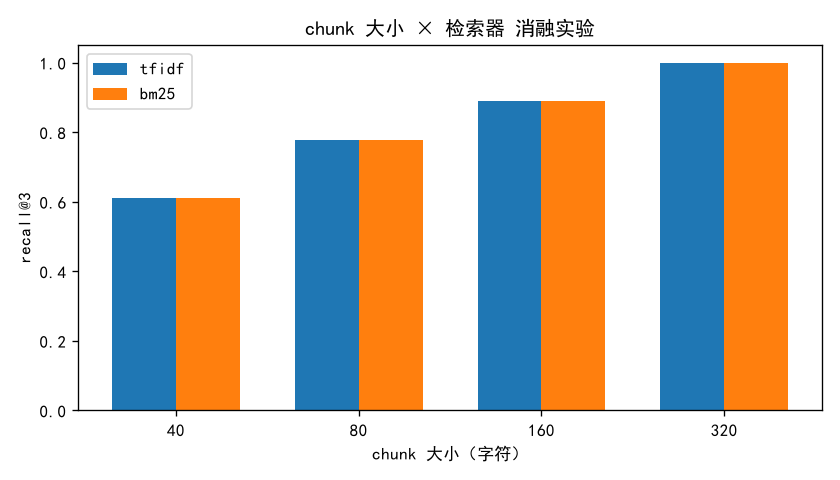

# mini-rag：从零实现一个迷你 RAG

> 不用 LangChain，不用 LlamaIndex——只用 Python 标准库和 numpy，
> 亲手实现检索增强生成（RAG）的每一层。

<!-- TODO: 在这里放演示 GIF：python app.py ask "..." 的录屏 -->

## 这是什么

7 个逐步递进的 Python 文件，每个文件独立可运行、配中文讲解和 pytest 测试。
按顺序读完，你将亲手实现：

```
文本切块 → TF-IDF 检索 → 词向量 → 向量索引
        → 混合检索 → 带引用的问答 → 效果评测
```

最终得到一个能对自己本地文档提问、答案可溯源的命令行工具。

## 效果先看

对一个装着《高等数学》《大学英语》复习笔记的目录直接提问（离线模式，零 API）：

```
$ python app.py ask "泰勒公式有什么用" --offline

【离线模式】未接入 LLM，以下是与问题最相关的原文片段：
[1] # 高等数学 · 第五章复习要点 ## 泰勒公式
    泰勒公式的核心思想是用多项式逼近复杂函数。在一点附近，用函数值与各阶
    导数构造多项式，阶数越高逼近越好……（来源：高等数学.md#0）
[2] 带拉格朗日余项的泰勒公式在证明题中尤其常用……（来源：高等数学.md#1）
[3] 牛顿-莱布尼茨公式（微积分基本定理）指出……（来源：高等数学.md#3）
```

**03 · 词向量**：只用共现矩阵 + PPMI + SVD，"温习"自动成为"复习"的第一近邻：

```
与「复习」最相近的词：温习(0.705), 然后(0.360), 做(0.360), 课文(0.360), 她(0.224)
sim(复习, 温习) = 0.705
sim(复习, 足球) = -0.006
```

**04 · IVF 索引**：5 万条向量上，牺牲 1% 召回换 7.6 倍提速：

```
暴力检索总耗时：29.8 ms
nprobe     耗时(ms)  recall@10
     1        2.9       0.60
     5        3.9       0.99     <- 甜点位：0.99 召回，快 7.6 倍
    10        4.1       1.00
    50       40.0       1.00
```

**07 · 消融实验**：chunk 大小对召回率的影响，一张表说清（图由评测脚本自动生成）：

| chunk 大小 | 检索器 | recall@3 | MRR |
|---|---|---|---|
| 40 | tfidf | 0.611 | 0.944 |
| 80 | tfidf | 0.778 | 1.000 |
| 160 | tfidf | 0.889 | 1.000 |
| 320 | tfidf | 1.000 | 1.000 |



## 课程目录

| # | 文件 | 内容 | 你会学到 |
|---|------|------|----------|
| 1 | [01_chunking.py](01_chunking.py) | 文本切块 | chunk 大小 / overlap 的取舍 |
| 2 | [02_sparse_search.py](02_sparse_search.py) | TF-IDF + 余弦相似度 | 倒排索引思想、中文 bigram 分词 |
| 3 | [03_embeddings.py](03_embeddings.py) | 共现矩阵 + PPMI + SVD | 词向量从哪来、一阶/二阶相似性 |
| 4 | [04_vector_index.py](04_vector_index.py) | 暴力检索 → IVF 索引 | 为什么需要 ANN、速度/精度权衡 |
| 5 | [05_hybrid_search.py](05_hybrid_search.py) | BM25 + RRF 混合 | 什么时候向量检索反而输给关键词 |
| 6 | [06_answer.py](06_answer.py) | 带引用的生成 | prompt 组装、防引用幻觉、诚实降级 |
| 7 | [07_evaluation.py](07_evaluation.py) | recall@k / MRR | 怎么科学地证明改进有效 |

✅ 全部模块已实现并通过 28 个 pytest 用例（CI 覆盖 Python 3.10 / 3.12）。

## 快速开始

```bash
git clone https://github.com/F1EE7/mini-rag.git
cd mini-rag
pip install -r requirements.txt        # 只需要 numpy

# 逐模块学习（每个文件都能直接运行）
python 01_chunking.py

# 或者直接用：对你自己的文档提问
python app.py index ./你的资料目录      # 支持 .txt / .md
python app.py ask "你的问题" --offline # 离线模式，不需要任何 API
```

可选增强（不装不影响上面任何功能）：

```bash
pip install pypdf                    # app 支持读取 PDF 课件
pip install sentence-transformers    # 检索自动加入语义向量一路
pip install matplotlib               # 07 评测自动生成对比图
```

## 为什么从零写

- **框架会魔术**：`VectorStore.from_documents()` 一行跑通，但面试官问
  "为什么 chunk 不能太大"就露馅。这里每一层都是你自己写的。
- **只用 numpy**：全仓库核心只依赖 numpy，任何机器 clone 下来就能跑。
- **有实验数据**：每个模块附带真实消融实验（chunk 大小、IVF 速度/召回、
  BM25 vs TF-IDF），不只讲 what，还讲 why。

## FAQ

**Q：需要 OpenAI API 吗？**
不需要。默认离线可跑；`06_answer.py` 接入 LLM 后才需要 API
（OpenAI 兼容接口，通过 `MINIRAG_BASE_URL` 可指向任意中转/本地服务）。

**Q：为什么不直接用 LangChain？**
见「为什么从零写」。这不是反框架，而是先把原理焊死再上车。

**Q：评测集太小，结论可信吗？**
本仓库的评测是**方法论演示**：教你消融实验怎么设计、指标怎么算。
把 `07_evaluation.py` 的语料换成你自己的 + 更多 QA 对，就是可复用的评测脚手架。

## License

[MIT](LICENSE)
